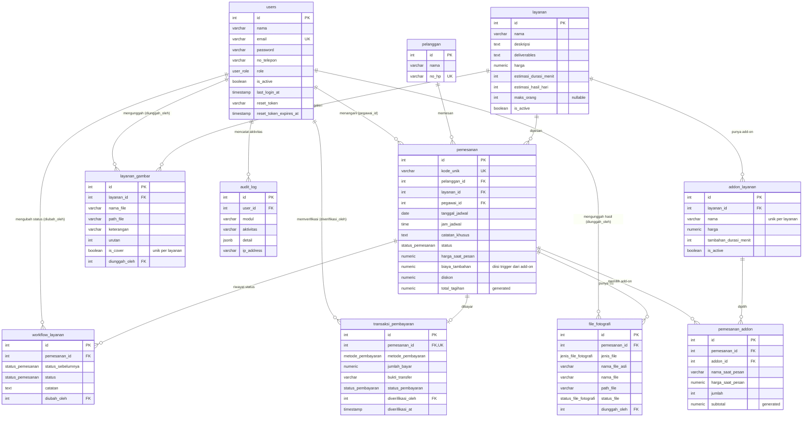

# ERD SIMASIF (11 tabel)

Catatan relasi:

- `pemesanan_addon.addon_id` → `ON DELETE RESTRICT`: add-on yang sudah pernah dipesan tidak bisa dihapus, hanya dinonaktifkan.
- `layanan_gambar` dan `addon_layanan` → `ON DELETE CASCADE` dari `layanan`.
- `pemesanan.biaya_tambahan` otomatis = total `pemesanan_addon.subtotal` (trigger `sync_biaya_tambahan`).